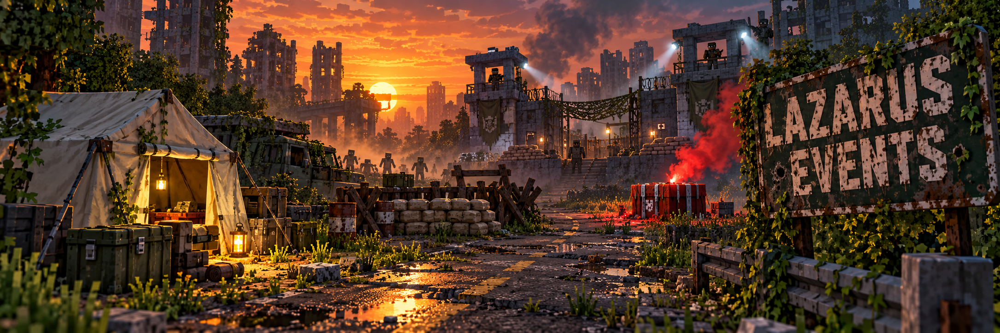

<p align="center">
  
</p>

<p align="center">
  
  
  
  
</p>

# Lazarus Events

**Lazarus Events** é um mod para Minecraft Forge 1.20.1 criado para o modpack **Project Lazarus**. Ele espalha pequenos encontros pelo mundo enquanto o jogador explora: acampamentos abandonados, barricadas após disparos, pedidos de socorro (verdadeiros ou não), defesas contra hordas, bases militares, esconderijos de hostis, ninhos de zumbis, zonas de gás de infecção e quarentenas militares. Cada cenário tem uma construção própria, personagens ou infectados e recursos que fazem sentido para o local. Também mantém as bases permanentes das facções Rovers e Wardens, o refúgio do Haven, o projeto vacina e o colapso militar ao longo dos dias.

Os encontros são colocados em áreas já carregadas do *Overworld*. O mod não força a geração de chunks, não depende dos antigos scripts de eventos do KubeJS e guarda o progresso separadamente em cada mundo. As novas bases de facção usam apenas chunks recém-gerados. Os textos dentro do jogo estão em inglês, seguindo o padrão do modpack.

---

## Sumário

- [Encontros](#encontros)
- [Hostis na história do mundo](#hostis-na-história-do-mundo)
- [Ninhos de zumbis](#ninhos-de-zumbis)
- [Zonas de infecção (gás)](#zonas-de-infecção-gás)
- [Refúgio do Haven](#refúgio-do-haven)
- [Bases e rivalidade de facções](#bases-e-rivalidade-de-facções)
- [Territórios (CityWorld)](#territórios-cityworld)
- [Como aparecem](#como-aparecem)
- [Comandos para testar](#comandos-para-testar)
- [Configuração](#configuração)
- [Instalação](#instalação)
- [Documentação do projeto](#documentação-do-projeto)
- [Créditos e licença](#créditos-e-licença)

---

## Encontros

| Evento | Desde o dia | O que o jogador encontra |
|---|:---:|---|
| **Cache** | 1 | Pequeno acampamento com tenda branca, cama, fogueira, lanternas, defesas improvisadas, infectados e suprimentos em um barril. |
| **Gunfire** | 1 | Barricada de estrada com sacos de areia e cobertura de madeira, onde um soldado enfrenta infectados. |
| **Flare** | 1 | Marca de resgate no chão, sinalizador vermelho, infectados e uma **Medical Drop Box** do Apocalypse Now. |
| **Rescue** | 1 | Sobrevivente ferido junto a um sinalizador, pedindo bandagens e escolta até um lugar seguro. |
| **Last Defense** | 3 | Três sobreviventes defendem uma barricada e pedem reforço contra ondas de infectados. |
| **False Radio** | 6 | Um pedido de socorro pelo rádio que é uma emboscada de saqueadores em volta de um acampamento com carga. |
| **Military** | 10 | Base militar guardada por quatro militares, com barris de suprimentos, geladeira e gerador ligado. Fica mais rara a partir do dia 21 e rara a partir do dia 36. |
| **Abandoned** | 21 | O mesmo posto militar sem soldados: barril de suprimentos, infectados de farda e um diário de serviço num atril. Comum a partir do dia 36. |
| **Gang hideout** / **Gang building hideout** | 6 | Esconderijo de gangue ao ar livre ou num cômodo de prédio do CityWorld, com saqueadores guardando o loot. |
| **Hollow den** | 10 (à noite) | Covil dos canibais do Hollow num prédio, com um prisioneiro do Haven para libertar. |
| **Zombie nest** | 8 | Pústulas num prédio que geram infectados até serem destruídas; em volta, uma zona infestada. |
| **Smuggler den** | 6 | Trecho de esgoto do CityWorld fechado com grades e uma porta, com o melhor estoque da gangue local. |
| **Deserter camp** | 21 | Posto militar tomado por desertores. |
| **Infection zone** | 12 | Gás verde num espaço fechado; máscara ou hazmat obrigatórios. |
| **Military quarantine** | 21 | Uma quarentena militar que falhou, com perímetro, tenda de descontaminação e gás no prédio. |

Os detalhes dos hostis, ninhos, zonas de gás e quarentena estão nas seções abaixo. Rescue, Last Defense, False Radio e Military usam a API do **Lazarus NPCs**: ordens aos personagens (esperar, seguir, guardar, recuar), conversa com escolhas, tarefa no diário (aba **Encounters**) e recompensa. Só um jogador por vez pode aceitar a tarefa de um mesmo personagem.

### Rescue

O sobrevivente pede **duas bandagens**. Depois de tratado, segue o jogador até um **ponto seguro** a cerca de 40 blocos, na direção de onde o jogador veio. Ao chegar, o jogador recebe **2 comidas enlatadas, 1 água enlatada e 1 antibiótico** e **+5 de reputação** com a facção do sobrevivente. Se ele morrer, a tarefa falha. Se a tarefa for abandonada ou vencer, ele volta a esperar e outro jogador pode ajudar.

### Last Defense

Os três defensores são da mesma facção. Quem aceita precisa **ficar a até 24 blocos da barricada por dois minutos**; o tempo só conta com o jogador por perto. Os infectados chegam em **três ondas de 6, 9 e 12** (mais um a cada dez dias de mundo, até +4). Cada defensor que cai é anunciado; se todos caírem, a tarefa falha. Recompensa: **3 comidas enlatadas, 2 bandagens** e **+2 de reputação por defensor vivo** (até +6) com a facção deles.

### False Radio

Três saqueadores guardam a carga. Quando o jogador chega a 20 blocos, **um deles vai até ele** e faz a exigência pessoalmente; o grupo segura o fogo por 30 segundos de conversa, e atacar encerra a trégua na hora. A conversa tem quatro saídas:

- **Pagar 3 comidas enlatadas:** o grupo deixa o jogador passar, mas a carga fica com eles.
- **Blefar** que há uma patrulha chegando: uma tentativa; metade das vezes eles acreditam e se afastam, deixando a carga.
- **Brigar pela carga:** tarefa opcional, concluída quando não resta saqueador perto da carga (mortos, em fuga ou rendidos), com **2 comidas enlatadas e +2 Wardens**.
- **Ir embora.**

Não há troca amigável. A mensagem de descoberta e o rádio não revelam que é uma armadilha. Se o jogador simplesmente se aproximar, valem o aviso e o pedágio normais dos saqueadores.

### Military

Os militares do Lazarus NPCs usam skins próprias: três soldados (atirador, operador de rádio e soldado de quarentena com máscara de gás) e o médico de campo, com farda alinhada e insígnia olive, ao contrário dos desertores. Os soldados **guardam a base** e o médico fica no posto. A recepção depende da reputação com os **Military**: abaixo de 10, área restrita, mas é possível oferecer ajuda; a partir de 10, boas-vindas; com -20 ou menos, o jogador é mandado embora. A tarefa **Secure the perimeter** traz três ondas de infectados contra a cerca: mate **12 atacantes** e volte ao soldado que deu a ordem para receber **30 munições 5.56, 2 bandagens e +3 Military**.

Com Military **10 ou mais**, o soldado aceita um **pedido de suprimento aéreo**: por **3 comidas enlatadas e -4 Military**, entrega uma pistola sinalizadora do **dyairdrop** (recarga de 3 dias por jogador). Disparada em área aberta, ela chama um airdrop real, que atrai infectados.

### Projeto vacina

Os infectados especiais do **Undead Revamped** (Heavy, Bomber, Spitter, Hunter e outros) deixam uma **amostra infectada** com 6% de chance quando o jogador os mata. Qualquer soldado ou médico de um posto militar ativo oferece a tarefa **Samples for the lab**: entregar **3 amostras** paga **1 antibiótico, 2 bandagens e +3 Military**. A cada **3 entregas**, o jogador também recebe um **soro experimental**.

O soro é bebido como uma poção: **cura a infecção do The Hordes e impede uma nova por um dia de jogo**, com 30 segundos de náusea. Como os antibióticos já curam a infecção, o valor do soro é a proteção, por exemplo antes de enfrentar uma horda.

### Colapso militar

Com o passar dos dias, os postos militares ativos ficam raros e os **abandonados** tomam o lugar deles. Cada posto abandonado tem um dos seis diários de serviço (evacuação, ordens cortadas, deserção) no atril do centro.

## Hostis na história do mundo

Os humanos hostis têm identidade própria e deixam provas quando o jogador os mata (um rendido nunca deixa nada):

| Grupo | Quem são | Prova | Quem paga |
|---|---|---|---|
| **Desertores** (Soldiers) | Soldados que abandonaram os postos durante o colapso; usam uma de três skins próprias do Lazarus NPCs (farda suja, trapo vermelho no braço) | **Placas de identificação** (60%) | Soldado ou médico de um posto militar ativo: **3 placas** dão +2 Military e 30 munições 5.56 |
| **Gangues** (Looters) | Gangues de rua com território: o nome muda a cada 512 blocos (Rust Dogs, Lantern Boys, Crowbar Saints, Red Tape, Gutter Kings, Static, Tin Men, Black Pine) | **Insígnia** com o nome da gangue (30%) | Líder ou guarda dos Wardens: **3 insígnias** dão +2 Wardens, 2 comidas enlatadas e 1 bandagem |
| **The Hollow** (Cannibals) | Um culto noturno que some com sobreviventes; usam três skins próprias (o pregador, o açougueiro e o de olhos vazados) | **Amuleto de osso** (40%) | Líder do refúgio do Haven: **2 amuletos** dão +3 Haven e 1 antibiótico |

O aviso e a tela de negociação dos saqueadores citam a gangue do lugar. Qualquer hostil morto pode deixar um **bilhete** (15%): são cinco textos por grupo, como cartas de desertores, listas de pedágio das gangues e rabiscos do culto. Quem carrega provas suficientes é recebido primeiro com a oferta de pagamento; a opção "Something else" deixa conversar normalmente por um minuto.

### Esconderijos

Dois encontros novos mostram onde os hostis vivem. Quem tem walkie-talkie ouve a conversa interceptada com a região aproximada.

**Rádio.** Todo encontro novo, natural ou criado por comando de teste, é anunciado a quem estiver a até 192 blocos com um **walkie-talkie** (`ifreq:walkie_talkie`) em qualquer lugar do inventário. A mensagem aparece no chat com a etiqueta **[RADIO]** em verde, um chiado, o texto em itálico e a região aproximada em amarelo, acompanhada de um bipe. Ela não depende da frequência do aparelho.

| Esconderijo | Desde | O que há | Ao limpar |
|---|:---:|---|---|
| **Deserter camp** | dia 21 (mais comum a partir do 36) | O posto militar ocupado por 3 ou 4 desertores **armados**, barril de suprimentos militares e um bilhete de desertor no atril | +2 Military |
| **Gang hideout** | dia 6 | Acampamento de 3 ou 4 saqueadores da gangue local, com o "caixa" da gangue: loot de suprimentos e uma insígnia garantida | +2 Wardens |
| **Hollow den** | dia 10, **só à noite** | Um cômodo de prédio tomado pelo culto: ossos, crânio, velas acesas, fogueira apagada, 2 ou 3 canibais e um **sobrevivente preso** numa jaula de grades no canto. O rádio do Haven pede ajuda por alguém que não voltou | +2 Haven; o cativo é libertado e vai para o refúgio se houver vaga |
| **Gang building hideout** | dia 6 | Um cômodo de um prédio já existente (CityWorld ou qualquer construção coberta) tomado pela gangue local: barril do "caixa" com insígnia, caixotes, colchonetes, um lampião e uma placa "TURF / KEEP OUT" com o nome da gangue, sem mexer nas paredes | +2 Wardens |

O esconderijo conta como limpo quando um jogador viu os ocupantes e nenhum restou vivo; quem estiver a até 32 blocos recebe a reputação, uma vez só. A opção `enableHostileHideouts` desliga os dois.

### Prisioneiros

Quando um saqueador ou desertor se rende, a tela de rendição ganha duas opções além de **tomar o que carrega** e **soltar** (que agora dá +1 Haven):

- **Interrogate:** uma vez por prisioneiro. Ele entrega o esconderijo do grupo, que é criado agora a 80–160 blocos em área já carregada: acampamento de desertores para soldados; esconderijo de gangue ou cômodo de prédio tomado pela gangue para saqueadores. O prisioneiro diz a direção e a distância, e uma tarefa **Find the hideout** vai para o diário com o destino. Se não houver lugar válido por perto, ele não diz nada útil.
- **Send to refuge:** só aparece se o refúgio do Haven tiver um beliche de hóspede livre. O prisioneiro deixa as cores da gangue e vai recomeçar no refúgio, com roupa de sobrevivente e nome novo. Dá +2 Haven.

### Esconderijos habitados

Os esconderijos em prédio (gangue e covil do Hollow) ocupam o cômodo encontrado e os vizinhos atrás das portas (até 4 cômodos para a gangue, 3 para o Hollow). Cada cômodo é esvaziado e mobiliado com os **kits de móveis** conforme o tamanho: o maior vira sala comum (cozinha e guarita), os outros dormitório, oficina e depósito, sempre com passagens livres entre as portas. Cada grupo tem identidade própria (kits exclusivos e troca de blocos, descritos em [docs/IDENTIDADE_GRUPOS.md](docs/IDENTIDADE_GRUPOS.md)): a gangue em vermelho, preto e amarelo com estandartes, pneus e sucata; os contrabandistas com caixas militares, paletes e mesa de contagem; o Hollow com velas, ossos, altar e carne pendurada. A gangue guarda o estoque no depósito e marca a sala comum com a placa TURF; o Hollow prende o refém numa jaula num canto longe das portas, entre ossos, velas e uma fogueira apagada.

## Ninhos de zumbis

A partir do **dia 8**, a infecção pode criar raiz num cômodo de prédio (ou porão): **3 a 5 pústulas** (blocos vermelhos e carnudos, que os zumbis não comem) junto às paredes, teias, esporos no ar e gemidos. O rádio avisa: *"Military band: biological growth reported inside a building, avoid the area"*.

- Enquanto houver pústulas e alguém a até 48 blocos, o ninho gera **um infectado a cada 20–30 segundos** (no máximo 6 vivos dele ao mesmo tempo): walkers, runners e zumbis comuns; do dia 20 em diante, às vezes um especial do Undead Revamped.
- Cada pústula quebrada solta uma **amostra infectada** (projeto vacina) e deixa o ninho mais lento.
- Sem a última pústula, o ninho morre: **+2 Military e +2 Haven** para quem estiver a até 32 blocos.
- O ninho **não some sozinho**: continua no mundo até ser destruído. A opção `enableZombieNests` desliga.

### Zona infestada

Enquanto o ninho vive, os **64 blocos** em volta viram zona infestada:

- **Mais infectados nas ruas:** até 20 a mais por jogador presente (até 3 a cada 5 segundos), surgindo a 24–40 blocos, sempre fora da vista (atrás ou ao lado do jogador).
- **Loot melhor:** contêineres de estrutura ainda fechados ganham **um item extra** de suprimentos do tier atual na primeira vez que são abertos.
- **Aviso:** ao entrar pela primeira vez, uma mensagem de rádio avisa da zona e da direção do ninho.
- Tudo acaba quando o ninho morre; os infectados que já estavam na rua ficam como zumbis comuns.

## Zonas de infecção (gás)

A partir do **dia 12**, um vazamento químico pode encher de **gás verde** um espaço fechado, de preferência subterrâneo: porão, esgoto ou cisterna do CityWorld, ou um cômodo de prédio. O rádio avisa: *"Military band: chemical leak detected underground, masks mandatory"*. A nuvem é visível (partículas verdes) e chia de vez em quando.

- **Sem proteção**, a cada segundo dentro do gás: náusea e tosse; depois de 5 s, veneno; depois de 15 s, **1 coração de dano por segundo** (mata em cerca de 25 s). A cada 10 s há 25% de chance de pegar a **infecção do The Hordes** (o soro experimental protege).
- **Máscara de gás** na cabeça (tag `lazarusevents:gas_masks`: as máscaras e capacetes hazmat do Apocalypse Now) bloqueia tudo, mas **perde 1 de durabilidade a cada 2 s** no gás. Usar um **Breathing Filter Module** com a máscara posta a deixa nova.
- **Roupa hazmat completa** (tag `lazarusevents:hazmat`) bloqueia sem gastar nada.
- Zumbis não são afetados. NPCs humanos sem máscara sofrem e fogem para a saída mais próxima.
- No ponto mais fundo, longe das saídas, há um **barril com loot médico** do tier atual e 30% de chance de um **soro experimental**.
- O gás dura **2 dias de jogo** e se dissipa com aviso no rádio. A opção `enableInfectionZones` desliga.

### Quarentena militar

A partir do **dia 21**, o rádio repete em loop: *"quarantine zone breached, containment team lost"*. Num prédio, uma zona de gás que o exército tentou isolar e perdeu:

- **Na frente da porta para a rua** (o prédio precisa de uma; escadarias e átrios não contam): um perímetro em U de cerca de arame com 2 de altura e arame farpado em cima, postes com lanterna, portão de sacos de areia atrás de uma chicana de barreiras de concreto, placas (QUARANTINE, BIOHAZARD – LETHAL FORCE AUTHORIZED, DECON REQUIRED) e um trecho derrubado por onde a contenção rompeu;
- **tenda de descontaminação** encostada na fachada: postes, teto branco e piso de concreto, com dois chuveiros (caldeirões com água), barril de lixo tóxico, uma maca e um barril de máscaras quase gastas;
- **o fracasso:** sacos de corpo enfileirados, caixas militares reviradas, o baú de um soldado caído e um **rádio de campanha** que, com o jogador por perto, repete chamadas da unidade de contenção;
- **2 ou 3 soldados infectados** de máscara e colete ainda no posto; as outras entradas ficam lacradas com arame e barreiras de concreto;
- **dentro:** o cômodo é esvaziado antes (móveis, baús e enfeites saem; paredes, portas, janelas, escadas e luzes ficam); depois vêm o gás saindo de um barril tóxico vazando (fumaça mais densa), uma enfermaria improvisada (camas brancas, papéis e panos de corpo), **infectados de hazmat e pacientes**, um diário de serviço no atril e, no fundo, um **estoque militar** (loot de armas do tier atual, 40% de chance de máscara ou filtros);
- matar todos os infectados, de fora e de dentro, dá **+2 Military** a quem estiver lá. O gás continua até expirar (2 dias). A opção `enableQuarantines` desliga.

## Refúgio do Haven

O **Haven** também tem uma base permanente, o **refúgio**: paliçada de toras, cabana do líder, alojamento com camas, tenda de enfermaria, horta com poço, fogueira central e a banca do comerciante junto ao portão. O Haven **não tem rivais**: o refúgio nunca é alvo de roubo, reconhecimento ou confronto, e o Haven não manda expedições armadas.

Moram ali **seis pessoas** fixas: o líder, dois guardas (um faz a ronda, outro vigia o portão), um comerciante e dois médicos. À noite, o líder e um médico dormem; os demais se recolhem ou ficam de guarda. Com reputação Haven **10 ou mais**, o comerciante do refúgio dá **15% de desconto**, e sobreviventes Haven soltos pelo mundo aceitam **contrato de guarda**, como os Wardens. Os médicos estabilizam como nas outras bases.

**Pedido do dia.** O líder do refúgio pede uma coisa por dia, a mesma para todos os jogadores. Cada jogador pode atender **uma vez por dia**:

| Pedido | Entregar | Recompensa |
|---|---|---|
| Comida | 4 comidas enlatadas | +3 Haven, 1 antibiótico |
| Água | 3 águas enlatadas | +3 Haven, 2 bandagens |
| Remédios | 2 bandagens e 1 kit médico | +4 Haven, 2 comidas enlatadas |
| Tecido | 6 tecidos | +2 Haven, 8 sementes de trigo e 1 comida enlatada |

**Resgatados viram moradores.** Quando um **Rescue** termina bem e o refúgio existe, o sobrevivente salvo vai morar lá, com o mesmo nome e aparência, se houver vaga: são **quatro beliches de hóspede**. Ele aparece perto da fogueira, agradece pelo nome a quem o salvou, e o líder conta quantas pessoas o jogador já trouxe com vida. Se um hóspede morre, a vaga fica livre para o próximo resgate.

## Bases e rivalidade de facções

O catálogo `BaseRoster` define quais facções têm bases, seus modelos e vagas. Missões e escaramuças consultam as relações de `NpcFactions` no Lazarus NPC's; não dependem de um par fixo de facções. Saves de bases sem perfil instalado são preservados e confrontos antigos Rovers × Wardens são migrados ao carregar. Para adicionar uma facção, registre a identidade em NPC's e inclua seu perfil, template e conteúdo neste mod.

Rovers e Wardens podem estabelecer **uma base permanente por facção** no Overworld, fora da região de spawn. A base fica registrada no save em dados próprios: não expira com os encontros comuns nem é reconstruída ao recarregar. Barris saqueados e alterações feitas pelo jogador permanecem. Cada base nova tem **dez moradores**, com a distribuição ajustada ao estilo da facção:

| Profissão | Rovers | Wardens | Função |
|---|:-:|:-:|---|
| Líder | 1 | 1 | Único que oferece e recebe missões de facção. |
| Guarda | 3 | 4 | Dois patrulham rotas curtas; os demais são sentinelas fixas (torre dos Rovers, portão dos Wardens). |
| Armeiro | 1 | 1 | Armas, munição, proteção e reparo. |
| Comerciante | 2 | 1 | Comida, remédios e suprimentos; os Rovers, voltados a viagem e troca, têm dois. |
| Médico | 1 | 1 | Estabilização (2 bandagens e 1 água enlatada) dentro da base. |
| Soldado de expedição | 2 | 2 | Descansam na base entre patrulhas; não dão missões nem vendem. |

Se o líder morrer, o primeiro guarda vivo assume como interino. Baixas são repostas após um dia de jogo, sem duplicar moradores ao carregar chunks. Bases criadas por versões anteriores mantêm as cinco vagas originais.

Cada vaga possui uma rotina: os civis alternam tarefas no posto, conversa e refeição; três moradores do modelo novo têm cama, os outros se abrigam à noite, e os guardas vigiam postos de defesa. Um ataque a qualquer morador coloca a base em alerta por 30 segundos. Os defensores perseguem a ameaça e os civis procuram abrigo; a rotina é reenviada ao carregar o morador e ao renovar a ordem.

Quando as duas bases existem, **apenas o líder** oferece pelo diálogo duas tarefas no diário: **reconhecimento**, observando a base rival de 16 a 48 blocos de distância por cinco segundos e voltando ao emissor; e **roubo**, levando um pacote selado do depósito rival de volta ao emissor. O pacote é ligado à instância da missão e precisa estar no inventário na entrega. Uma missão só paga uma vez. Se o líder morrer, um guarda assume como interino e pode receber relatórios de tarefas em andamento; após um dia, passa a oferecer novas tarefas. Se um guarda presencia o roubo, a reputação com a facção roubada cai. As recompensas incluem suprimentos e reputação; a mudança política afeta a facção rival conforme as regras do Lazarus NPCs 1.8.0.

O armeiro vende armas, munição e proteção; o comerciante concentra comida, remédios e suprimentos de viagem. Seus estoques usam o sistema de trocas do Lazarus NPCs e não são repostos pela migração de mundo. Fora das bases, **expedições raras** de três soldados Rovers ou Wardens podem aparecer em terreno seguro e carregado; seguem uma rota de quatro a seis pontos, reagrupam após combate e duram até dez minutos. Não ocupam vagas permanentes e têm intervalo padrão de cinco dias, ajustável na configuração. Converse com um soldado de expedição: se você ainda não visitou a base da facção dele, ele indica a direção e a distância e oferece **marcar a base no diário** (tarefa *Find the outpost*, com o destino exato; chegar a 24 blocos conclui e rende +2 de reputação). Se a facção ainda não tem base, ele avisa que o grupo segue procurando um local.

A expedição termina quando um ponto da rota deixa de estar carregado. Os integrantes descarregados são reconhecidos e descartados quando voltam a carregar; isso evita patrulhas órfãs no save.

Perto de uma base, pode ocorrer uma **escaramuça Rovers × Wardens** com três combatentes de cada lado. Os grupos começam a 48 blocos um do outro, aproximam-se por uma rota curta e passam ao combate. A geração natural procura colocá-los fora da vista direta dos jogadores. O combate fica ativo somente em área carregada, dura até cinco minutos e respeita intervalo mínimo de três dias. Jogadores neutros podem assistir; somente quem causar dano a uma facção e ajudar o lado vencedor recebe reputação. Os combatentes são soldados de expedição, com a skin e a armadura dessa profissão em cada facção, e usam os arsenais e a doutrina de suas facções. O resultado muda modestamente o estoque registrado das bases; não destrói as construções.

As bases são construídas a partir de dois templates em `data/lazarusevents/structures/`, gerados por `tools/generate_faction_bases.py` (só biblioteca padrão do Python; o script também confere se postos, patrulhas e depósito são alcançáveis a pé a partir do portão):

| Base | Tamanho | Conceito |
|---|---|---|
| **Rovers: acampamento de caravana** | 23 × 21 | Cerca de sucata (chapas, pneus, cercas e pedra), portão de toras com lanterna, um ônibus amarelo como alojamento do líder, barraca dos guardas, fogueira no cruzamento das trilhas, torre de vigia com escada, oficina coberta do armeiro (bigorna, rebolo, caixa de ferramentas), barraca listrada do comerciante e um barracão de sucata com o depósito. |
| **Wardens: forte de controle** | 25 × 23 | Muralha de pedra com ameias e arame farpado, guarita dupla com escadas e sacos de areia, ninhos de sacos de areia no portão, bunker de comando com rádio e antena, alojamento com beliches, arsenal com grades, posto de suprimentos coberto, gaiola de grades com o depósito e mastro com bandeira azul. |

Plantas vistas de cima: [acampamento Rovers](docs/rovers_camp_preview.png) e [forte Wardens](docs/wardens_fort_preview.png). Bases criadas por versões anteriores mantêm a estrutura antiga e seus postos originais (modelo 1); só bases novas usam os modelos atuais. O diário mostra a posição do depósito rival (roubo) ou da base rival (reconhecimento) como destino da tarefa.

### Construções e loot

As construções são templates próprios capturados de cenários feitos no jogo. Seus blocos são adaptados à orientação do local. Tapetes de musgo e lajes do terreno podem ser substituídos pela construção quando há apoio sólido; água e terreno inseguro continuam impedindo a colocação. Encontros gerados antes de uma atualização não são reconstruídos retroativamente.

O cache usa uma tabela de suprimentos; os barris militares usam tabelas de armas e suprimentos do Dyairdrop. A Medical Drop Box usa o comportamento e o loot do próprio bloco do Apocalypse Now. Rescue reaproveita a marca do Flare, Last Defense a barricada do Gunfire e False Radio o acampamento do Cache, com a carga em um barril de suprimentos do Dyairdrop.

---

## Como aparecem

- Após a primeira entrada no mundo, a primeira tentativa natural é programada para cerca de **um dia de jogo** depois. Após um encontro bem-sucedido, a próxima tentativa ocorre em **1 a 2 dias**, por padrão.
- Cache, Gunfire, Flare e Rescue podem aparecer desde o começo; Last Defense a partir do **dia 3**; False Radio a partir do **dia 6**, junto com os saqueadores; e Military a partir do **dia 10**, por padrão. Pesos de sorteio entre os tipos liberados: Cache 9, Gunfire 6, Flare 4, Rescue 4, Last Defense 3, False Radio 3, Military 1 (0,5 a partir do dia 21 e 0,15 a partir do dia 36), Abandoned 1 (1,5 a partir do dia 36), Gang hideout 2 e Gang building hideout 2 (dia 6), Smuggler den 1,5 (dia 6, só com o CityWorld), Deserter camp 1 (1,5 a partir do dia 36), Hollow den 1,5 (dia 10, só à noite), Zombie nest 1,5 (dia 8), Infection zone 1,5 (dia 12) e Military quarantine 1 (dia 21).
- O mod procura um local adequado em chunks carregados, de 40 a 78 blocos do jogador, fora da direção para a qual ele está olhando. O terreno precisa ser seguro para a construção.
- Um local inválido adia a tentativa em vez de consumir o intervalo inteiro. O limite padrão é de **quatro encontros acompanhados** ao mesmo tempo; registros antigos expiram depois de sete dias de jogo.
- Ao chegar a 24 blocos de um encontro, o jogador recebe uma mensagem de descoberta. Quem carrega o *walkie-talkie* do Immersive Frequencies no inventário pode receber pelo rádio coordenadas aproximadas de um encontro recém-criado, se estiver a até 192 blocos.
- Bases de facção seguem um registro permanente separado e têm no máximo uma por facção, longe do spawn e de outra base.
  - **Chunks novos:** um em cada oito chunks recém-gerados vira candidato. Cada candidato testa 25 posições num raio de 12 blocos e escolhe a que exige menos terraplanagem. Se a base esbarra em chunks vizinhos ainda não gerados, o candidato espera e tenta de novo (até quatro vezes) em vez de ser descartado.
  - **Mundos já explorados:** a partir do dia 3 (configurável), uma facção sem base também tenta, a cada dois minutos, um local em chunks já carregados a 72–128 blocos de um jogador, fora do campo de visão dele e a pelo menos 56 blocos de qualquer jogador.
  - **Terreno:** flores, grama, mudas, neve, tapetes, lajes, folhas naturais e **árvores naturais** (troncos e cogumelos gigantes, inclusive a copa acima do telhado) são removidos; desníveis de até 3 blocos acima ou 4 abaixo do piso são cortados ou aterrados com terra. Contêineres, água, gelo e blocos construídos (tábuas, troncos descascados etc.) continuam impedindo a base. Os comandos permitem testá-las sem esperar a geração natural.

Essas distâncias e condições explicam por que um comando de teste pode responder **No valid location**. O modo `near` procura entre 14 e 34 blocos e dispensa a regra da direção da câmera; ele continua exigindo terreno e chunks válidos. Os eventos de interior (esconderijo em prédio, covil do Hollow, ninho, zona de gás e quarentena) usam o cômodo em volta do jogador no modo `near`, e um cômodo de prédio ou espaço subterrâneo próximo no modo natural.

---

## Territórios (CityWorld)

A partir da versão 0.22.0, o mod conversa com a API pública do **CityWorld** (`CityWorldAPI`) por reflexão: sem o CityWorld instalado, nada quebra e os eventos de território ficam desligados. Com ele, cada posição é classificada como **superfície**, **estação de metrô**, **túnel de metrô**, **mina**, **bunker**, **esgoto** (até 16 blocos abaixo da rua, já que esgotos não são lotes próprios na API) ou **caverna**.

Essa é a base da update de **eventos por território** (metrô, cavernas, esgotos e superfície), planejada em [docs/PLANO_EVENTOS_TERRITORIOS_V1.md](docs/PLANO_EVENTOS_TERRITORIOS_V1.md).

### Esgotos (0.23.0)

- **Ninhos e gás preferem esgotos:** com o CityWorld, 60% das vezes os ninhos de zumbis e as zonas de infecção procuram primeiro um esgoto a 30–80 blocos do jogador; sem esgoto por perto, voltam ao prédio ou ao subsolo de antes.
- **Esconderijo de contrabandista** (`smuggler_den`, a partir do dia 6): a gangue local fecha um trecho de túnel de esgoto com **grades de ferro** e uma única **porta**, e mora lá. Da porta para dentro: guarita, oficina, cozinha, dormitório e depósito, montados com os **kits de móveis**, ao longo de uma passagem livre; vigas de madeira com lanternas penduradas, piso de tábuas e **pontes** de tábuas sobre os canais de água. O melhor estoque (armas e munição com um distintivo da gangue no depósito, remédio com cigarros, suprimentos com bebida) é guardado por 3 ou 4 saqueadores. Só aparece em trechos com formato de túnel; limpar o lugar paga reputação política com os Wardens, como os outros esconderijos de gangue.

---

## Comandos para testar

Os comandos exigem permissão de operador, e os testes de colocação devem ser feitos no *Overworld*.

| Comando | Função |
|---|---|
| `/lazarusevents status` | Mostra o tempo até a próxima tentativa, o número de encontros acompanhados e o último resultado. |
| `/lazarusevents test cache near` | Procura um local próximo para o acampamento. |
| `/lazarusevents test gunfire near` | Procura um local próximo para a barricada. |
| `/lazarusevents test flare near` | Procura um local próximo para o sinalizador. |
| `/lazarusevents test military near` | Procura um local próximo para o posto militar, mesmo antes do dia 10. |
| `/lazarusevents test rescue near` | Procura um local próximo para o sobrevivente ferido. |
| `/lazarusevents test lastdefense near` | Procura um local próximo para a barricada defendida. |
| `/lazarusevents test falseradio near` | Procura um local próximo para a emboscada do falso sinal. |
| `/lazarusevents test <tipo> natural` | Usa a distância e a regra de direção dos encontros naturais; relata os motivos de rejeição. |
| `/lazarusevents where` | Mostra o que o CityWorld diz sobre a sua posição: território (superfície, estação ou túnel de metrô, mina, bunker, esgoto ou caverna), lote, profundidade abaixo da rua, linhas de metrô e a estação mais próxima. Sem o CityWorld, só distingue superfície e caverna. |
| `/lazarusevents scan` | Salva em `lazarus_scans/` (na pasta do jogo ou do servidor) um corte em texto dos blocos em volta do jogador, com legenda, para desenhar kits de esconderijo sobre a geometria real. |
| `/lazarusevents kit <nome> [grupo]` | Monta um kit de móveis (`data/lazarusevents/kits`) na parede para a qual o jogador está olhando, a até 5 blocos, para revisão; com um grupo (`gang`, `smugglers`, `deserters`, `hollow`), aplica o estilo dele. |
| `/lazarusevents locate <id>` | Mostra as coordenadas de um encontro registrado. O começo do ID é suficiente. |
| `/lazarusevents cancel <id>` | Para de acompanhar o encontro e remove seus personagens identificados; blocos e loot permanecem. Tarefas abertas desse encontro falham sem recompensa para os jogadores online. |
| `/lazarusbase list` | Lista as bases permanentes, guarnição e estoque. |
| `/lazarusbase locate <rovers\|wardens>` | Mostra o ID e as coordenadas da base. |
| `/lazarusbase inspect` | Inspeciona a base a até 32 blocos. |
| `/lazarusbase roles` | Mostra as vagas (dez nas bases novas), a profissão e o UUID de cada morador da base próxima. |
| `/lazarusbase expedition` | Tenta criar uma expedição temporária a 56–80 blocos do operador, em terreno carregado e seguro. |
| `/lazarusbase check <rovers\|wardens>` | Sem construir nada, procura o melhor local num raio de 16 blocos e mostra quantos blocos seriam terraplanados ou por que cada posição foi recusada (desnível, obstáculo, água). |
| `/lazarusbase create <rovers\|wardens>` | Cria a base no melhor local num raio de 16 blocos do operador, com o mesmo validador da geração natural; em caso de falha, resume os motivos e o bloco que impede a posição atual. |
| `/lazarusbase mission recon` / `theft` | Oferece a missão para teste quando o jogador está perto do líder da base e ambas existem. |
| `/lazarusskirmish status` | Mostra confronto atual ou último resultado. |
| `/lazarusskirmish test` | Inicia confronto no local do operador se houver área aberta e carregada. |
| `/lazarusskirmish clear` | Encerra apenas o confronto criado pelo comando de teste. |

`<tipo>` pode ser `cache`, `gunfire`, `flare`, `military`, `abandoned`, `deserter_camp`, `gang_hideout`, `gang_building_hideout`, `hollow_den`, `zombie_nest`, `infection_zone`, `military_quarantine`, `smuggler_den`, `rescue`, `lastdefense` ou `falseradio`. Os comandos de teste criam encontros reais no mundo, mas **não alteram o horário** do próximo evento natural. `gang_building_hideout near`, `hollow_den near`, `zombie_nest near`, `infection_zone near` e `military_quarantine near` precisam ser usados **dentro de um prédio**: o grupo ocupa o cômodo em volta do jogador. `smuggler_den near` precisa ser usado **dentro de um esgoto do CityWorld** (o comando `where` deve dizer `SEWER`).

---

## Configuração

O arquivo `config/lazarusevents-common.toml` é criado pelo Forge. Nele é possível ativar ou desativar o sistema e cada tipo de encontro, alterar o intervalo entre encontros, definir o primeiro dia de Military e os dias do colapso militar (`militaryDeclineDay` 21, `militaryCollapseDay` 36), ligar ou desligar os grupos novos (`enableHostileHideouts`, `enableZombieNests`, `enableInfectionZones`, `enableQuarantines`, `enableSmugglerDens`, `enableFactionExpeditions`), ajustar o limite de encontros acompanhados e escolher a partir de que dia as bases podem surgir em áreas já exploradas (`factionBaseFallbackDay`, 0 desliga). O estado dos encontros e o resultado da última tentativa são salvos por mundo.

---

## Instalação

### Requisitos

- **Minecraft 1.20.1**
- **Minecraft Forge 47.x** (desenvolvido com 47.4.10)
- **Java 17**
- **Apocalypse Now 3.0.5 ou superior**
- **Dyairdrop 1.0.0 ou superior**
- **Lazarus NPCs 1.16.0 ou superior**

Opcionais: o **Immersive Frequencies** (mensagens de rádio, com o walkie-talkie no inventário), o **CityWorld** (prédios, esgotos, metrô e minas usados pelos eventos; ver [Territórios](#territórios-cityworld)), o **The Hordes** (infecção pelo gás) e o **The Undead Revamped** (infectados especiais dos ninhos).

### Jogadores e servidores

1. Compile `lazarusevents-0.22.0.jar` em `build/libs/` ou [compile o projeto](#compilar-a-partir-do-código).
2. Coloque o JAR na pasta `mods` do perfil. No CurseForge, clique com o botão direito no perfil e escolha **Open Folder**.
3. Em multiplayer, instale o **mesmo JAR** no servidor e em todos os clientes.
4. Remova versões antigas de `lazarusevents` e reinicie o jogo ou servidor após a troca.

### Compilar a partir do código

Com JDK 17 instalado, execute na raiz do projeto:

```bash
./gradlew build
```

No Windows, use `gradlew.bat build`. O JAR gerado fica em `build/libs/`.

A compilação usa a API do Lazarus NPCs sem embuti-la: copie `lazarusnpcs-1.16.0.jar` para `libs/` antes de compilar. Os testes de ponta a ponta dos encontros ficam no projeto Lazarus NPCs.

---

## Documentação do projeto

- [docs/PENDENCIAS_E_TASKS.md](docs/PENDENCIAS_E_TASKS.md): estado das fases, tasks a implementar, pendências e testes instáveis.
- [docs/PLANO_EVENTOS_TERRITORIOS_V1.md](docs/PLANO_EVENTOS_TERRITORIOS_V1.md): plano da update de eventos por território.
- [docs/LORE_ZONAS_INFECCAO.md](docs/LORE_ZONAS_INFECCAO.md): lore das zonas e do gás de infecção, para versões futuras.

---

## Créditos e licença

- Desenvolvido para o **Project Lazarus** por **Kaique Melo**.
- Templates dos encontros: construções originais montadas em jogo para o projeto.
- Banner: arte gerada com IA para o Lazarus Events.
- Não é afiliado à Mojang ou à Microsoft.

**Licença:** All Rights Reserved.
